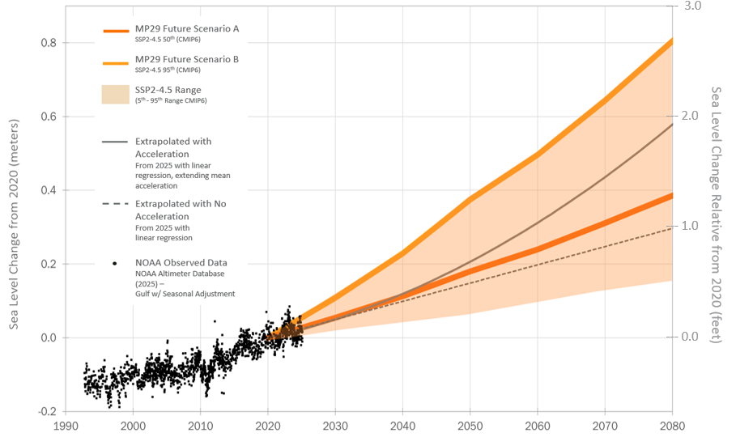

# Future Scenarios

We use future scenarios to understand how complex systems could change over 50 years, which helps us select projects that will have lasting benefits. Because even with the best modeling tools, we cannot predict or forecast exactly what will happen, model results best support planning within the context of known uncertainties and limitations related to [model performance](./predictive-models.md#model-performance). MP29 uses multiple future scenarios to represent future conditions across multiple environmental variables and investigate uncertainty around sea level rise. Candidate Project Evaluation using a range of plausible outcomes allows for selection of projects with robust benefits to better prepare for and adapt to changing conditions.

## MP29 Future Scenarios {/* #mp29-future-scenarios */}

Predictive Modeling for MP29 uses future scenarios to explore a range of plausible future conditions. To constrain and better understand outputs, all scenarios currently modeled for FWOA apply projections for changing environmental conditions derived from or aligned with the same set of assumptions related to future climate and emissions, specifically the Coupled Model Intercomparison Project Phase 6 (CMIP6) Shared Socioeconomic Pathway 2-4.5 (SSP2-4.5). This pathway generally assumes an extension of current trends and policies, providing a clear connection between current and future conditions, but it only represents one possible future in terms of climate policy and emissions. Other, also plausible, climate assumptions lead to different projections for environmental conditions that would result in lower or higher impacts to coastal Louisiana compared to projections derived from SSP2-4.5.

Although the values that serve as model inputs may vary spatially and/or over time, many environmental conditions are consistently applied across future scenarios for MP29 (Table 1).

_Table 1. Environmental Input Assumptions for the MP29 Future Scenarios applied for FWOA._

| Environmental Input | Modeled Values or Rates | How it is represented | Role in MP29 modeling | Source |
| --- | --- | --- | --- | --- |
| Precipitation | Variable over 50 years | Change over time, applied consistently across scenarios. | Influence hydrology, vegetation, and habitat suitability | SSP2-4.5 50th percentile projections |
| Temperature | Variable over 50 years | Change over time, applied consistently across scenarios. | Influence hydrology, vegetation, and habitat suitability | SSP2-4.5 50th percentile projections, historic data and anomalies |
| Evapotranspiration | Variable over 50 years | Change over time, applied consistently across scenarios. | Influence hydrology, vegetation, and habitat suitability | Temperature, Hargreaves-Samani |
| Tributary Flows | Variable over 50 years | Change over time, applied consistently across scenarios. | Provide hydrologic forcings | Precipitation; rating curves; seasonal wetness |
| River Flow (Mississippi and Atchafalaya) | Slight increase over 50 years | Change over time, applied consistently across scenarios. | Provide hydrologic forcings | ERDC projections (GFDL-ESM2G, CMIP5 RCP 4.5) |
| Storm Intensity (central pressure) | 5% increase by 2080 | Change over time, applied consistently across scenarios. | Influences storm surge | Knutson et al., 2020 and 2021 |
| Subsidence\* | Range from &lt;2 to &gt;18 mm/year | Spatially variable (interpolated); applied consistently across scenarios. | Directly impacts elevation | Benchmark-based observations |
| Population | No change | Applied consistently across scenarios | Contributes to flood risk damages | U.S. Census Bureau, NSI 26 structure data |
| Sea Level Rise | Increase of 0.16 to 0.81 m by 2080 | Changes over time; varies by scenario | Directly impacts water level | SSP2-4.5 5th to 95th percentile projections (downscaled) |

\* Shallow Soil Factor (SSF), which is calculated by ecoregion from CRMS observations of surface elevation change and spatially variable at -6 to &gt;2 mm/year, and accretion, which is dynamically calculated by ICM-Morph to account for accumulation of organic matter and mineral sediment, contribute to vertical land motion along with Subsidence.

Sea level rise is the one environmental input that varies across scenarios. For FWOA simulations, five sea level rise rates were modeled, all derived from downscaled SSP2-4.5 projections averaged across six Gulf gauges with vertical land motion excluded. Modeled rates represent the 5th, 17th, 50th, 83rd, and 95th percentile projections from SSP2-4.5 ensemble runs (Figure 4).

<figure>
    
    <figcaption>Figure 4. Regional CMIP6 Sea Level Projections, 5th to 95th percentile range with rates applied for Future Scenario A (50th percentile) and Future Scenario B (95th percentile) highlighted and observed data with extrapolated trends provided.</figcaption>
</figure>

### Project Selection Scenarios

Two future scenarios will support Candidate Project Evaluation and selection for MP29: MP29 Future Scenario A and MP29 Future Scenario B (Table 2). MP29 Future Scenario A applies a relatively lower sea level rise condition of 0.39 m from 2020 through 2079 that comes from the CMIP6 SSP2-4.5 50th- percentile projections and can be interpreted as a continuation of current trends. MP29 Future Scenario B applies a relatively higher condition of 0.81 m from 2020 through 2079 that comes from the CMIP6 SSP2-4.5 95th- percentile projections and can be interpreted as a “what if” scenario representing worse, but not worst, case conditions (Figure 4). Candidate project benefits will be evaluated across both project selection scenarios to check for robustness across possible future conditions.

Projected sea level differs by a relatively small amount between MP29 Future Scenarios A and B in the near-term because their rise is constrained by observed trends and processes already under way (Figure 4). The projections spread apart over time as uncertainty related to other processes, like ocean warming and icesheet and glacier loss, accumulates. In general, because MP29 Future Scenario B models a relatively higher rate of sea level rise, it is expected to produce greater land loss and deeper storm surge flooding than Scenario A, which models a relatively lower rate of sea level rise over 50 years. Because differences in projected sea level rise increase over time between the two project selection scenarios, greater differences in modeled outputs and metrics between the two scenarios are also expected further into the future.

_Table 2. Sea level rise assumptions for MP29 Future Scenario A and Scenario B._

| Scenario | SLR Rate Modeled | Role in MP29 Candidate Project Evaluation | Source |
| --- | --- | --- | --- |
| MP29 Future Scenario A | 1.27 ft (0.39 m), sea level rise 2020–2080 | Relatively lower MP29 project-selection sea-level-rise scenario. | CMIP6 SSP2-4.5 50th-percentile sea-level-rise projections (6 gages, vertical land motion excluded). |
| MP29 Future Scenario B | 2.64 ft (0.81 m), sea level rise 2020–2080 | Relatively higher MP29 project-selection sea-level-rise scenario. | CMIP6 SSP2-4.5 95th-percentile sea-level-rise projections (6 gages, vertical land motion excluded). |

### Interpreting Results Across Scenarios

Comparing [scenario-specific results](../results/index.md#scenario-specific-fwoa-results) across future scenarios shows how the direction or size changes with variable assumptions for sea level rise. Similar patterns indicate less sensitivity to the selected sea level rise assumption, while different patterns can help point to thresholds triggering shifts in modeled dynamics. Confidence products new for MP29 (i.e., [confidence-weighted land/water](../results/confidence-weighting.md#confidence-weighted-land-water) and [confidence-weighted land change](../results/confidence-weighting.md#confidence-weighted-land-change)) can provide additional context related to scenario assumptions that may improve understanding of possible future conditions and help inform decisions. As for any modeled results, these outputs should be considered along with documented limitations related to [model performance](./predictive-models.md#model-performance) and other technical information.
