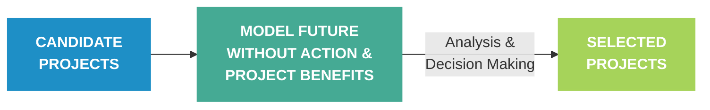

# Modeling Approach

## Overview

Louisiana’s coast is dynamic and ever-changing. We know the coast will continue to change in the future. While we can predict the direction and degree of change with relatively high confidence, the exact timing, extent, and effects of coastal change depend on too many unknowns to predict with certainty.

To develop the 2029 Coastal Master Plan (MP29), CPRA uses observations, predictive models, future scenarios, and post-processing methods to predict coastal change 50 years into the future. The results indicate how restoration and risk-reduction projects could affect future conditions. CPRA compares results across years, scenarios, geographic areas, and project alternatives. Each new plan reflects the data and scientific understanding available during its development. Modeled outcomes reflect anticipated patterns and trends at the scales represented by the models, not forecasts of exact conditions at any place or time.

Modeling is a fundamental component of the coastal master planning process, both to support understanding of a future without action and to assess potential future benefits of candidate projects (Figure 1).

<figure>

<figcaption><em>Figure 1. Coastal Master Planning Process</em></figcaption>

</figure>

The coastal master planning process uses specialized [Predictive Models](./predictive-models.md) to project coastal landscape change and corresponding risk of flooding from coastal storms for 50 years into the future. The [Modeling Framework](./modeling-framework.md) involves establishment of baseline conditions and future simulations. Future simulations are conducted first as Future Without Action (FWOA) runs and then as Future With Action (FWA) runs. FWA runs include candidate projects that aim to reduce land loss and/or storm surge-based flood risk and are repeated across multiple [scenarios](./future-scenarios.md) to allow for exploration of a range of potential outcomes. Deciding which Candidate Projects are selected to be included in each master plan involves evaluation of project effects using 1) modeled outputs and 2) metrics that help relate the outputs to master plan goals and objectives.

:::note

Outputs from MP29 FWOA runs are currently provided along with information on the current list of candidate projects. Additional candidate projects will be added from the second round of public solicitation for new project ideas, and information on those will be provided once available, followed by outputs from FWA runs.

:::
