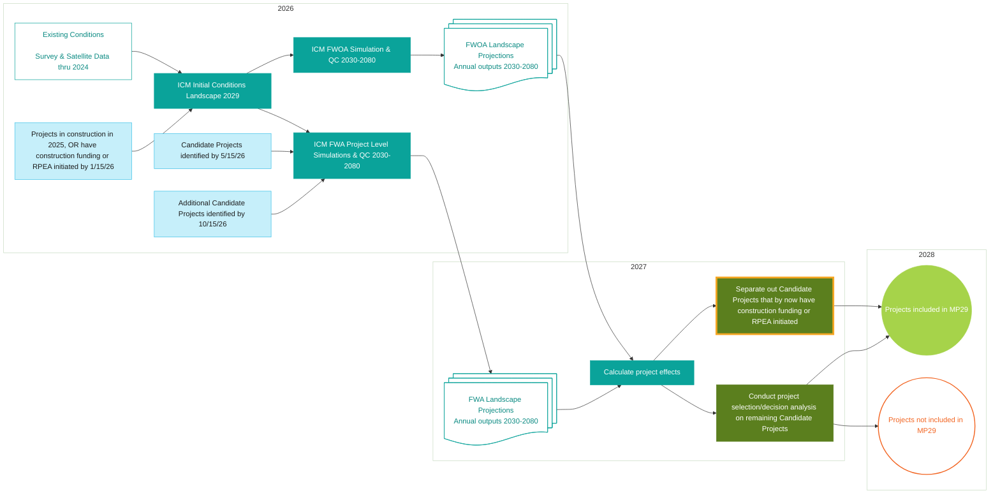

# Modeling Approach

## Overview

Louisiana’s coast will continue to change. The exact timing, extent, and effects of coastal change remain uncertain. Predictive models use observations and scientific understanding to estimate possible future conditions and compare restoration and risk-reduction options. The Coastal Protection and Restoration Authority (CPRA) uses these predictions to evaluate how projects could improve future conditions for coastal communities, businesses, and ecosystems.

To develop the 2029 Coastal Master Plan (MP29), CPRA uses observations, predictive models, future scenarios, and post-processing methods to predict coastal change over the 50-year planning horizon. The analyses estimate how restoration and risk-reduction projects could affect future conditions. CPRA compares results across years, scenarios, geographic areas, and project alternatives. Results describe possible conditions at the scales represented by the models; exact conditions at a particular place and time remain uncertain.

CPRA begins the modeling process by developing an empirical representation of existing coastal conditions from the best available survey, monitoring, satellite, elevation, land-cover, vegetation, hydrologic, and infrastructure data available through the end of 2024. These data establish the MP29 [existing conditions](./modeling-sequence.md#existing-conditions) landscape. CPRA inputs the existing conditions landscape then runs the Integrated Compartment Model (ICM) through a spin-up period representing environmental change and [eligible projects](./modeling-sequence.md#initial-conditions-project-criteria) implementation from 2025 through 2029. This process produces the end-of-2029 [initial conditions](./modeling-sequence.md#initial-conditions) landscape that serves as the starting point for MP29 future simulations, which begin in 2030 (see Figure 1).

The ICM applies environmental inputs and scenario assumptions to simulate annual changes in hydrology, salinity, elevation, land and water distribution, vegetation, habitat, and related ecological conditions. [Future Without Action (FWOA) simulations](../results/index.md#why-does-cpra-model-a-future-without-action) show how the coast could change with no further restoration or risk-reduction actions beyond those in initial conditions (see [Future Modeled Conditions and FWOA](./modeling-sequence.md#future-modeled-conditions-and-fwoa)). This baseline includes existing investments and eligible projects added during spin-up. CPRA evaluates Candidate Project effects by comparing FWOA results with Future With Action simulations, which include Candidate Projects.

ICM landscape outputs provide inputs to [MP29 risk models](#predictive-models-used-in-mp29): the Advanced Circulation (ADCIRC) and Simulating Waves Nearshore (SWAN) models, which analyze storm surge and waves, and the Coastal Louisiana Risk Assessment (CLARA) model, which analyzes flood risk. CPRA also applies post-processing methods to produce [planning metrics](./icm-components.md), including Land Area, Land Type, Vegetation Community Type, the Forested, Fresh, Intermediate, Brackish, Saline (FFIBS) score, Habitat Suitability Indices (HSIs), Habitat Diversity Index (HDI), and Wetland Value Assessment (WVA) results. FWOA results for these metrics are described in [Land and Water](../results/land-water.md), [Vegetation](../results/vegetation-habitat.md#vegetation), and [Habitat Quality](../results/vegetation-habitat.md#habitat-quality).

Observations establish the starting landscape. Environmental inputs and scenario assumptions define conditions over time. Models produce landscape, storm surge, wave, and flood-risk outputs that CPRA summarizes as [maps, time series, and planning metrics](../results/index.md#exploring-fwoa-results). Comparing Future With Action and FWOA results under the same scenario [identifies modeled project effects](../results/index.md#why-does-cpra-model-a-future-without-action). Comparing results across scenarios shows how project effects vary with future assumptions.

CPRA assesses confidence and uncertainty through documented assumptions, model calibration and validation, technical review, scenario comparisons, and [metrics that analyze results across scenarios](../results/confidence-weighting.md). The following sections describe the data ([Modeling Sequence and Starting Conditions](./modeling-sequence.md)), future assumptions ([Future Scenarios: Balancing Confidence and Uncertainty](./future-scenarios.md)), ICM components and outputs ([ICM Components](./icm-components.md)), and limitations ([Model Uncertainty](./how-to-look-into-the-future.md#model-uncertainty) and [Model Performance Review](./future-scenarios.md#model-performance-review)) that guide interpretation.

<figure>

<figcaption><em>Figure 1. Project pathways for inclusion in the 2029 Coastal Master Plan. The figure summarizes the relationship among existing conditions, the initial conditions landscape, Future Without Action simulations, Future With Action project-level simulations, project-effect calculations, and the pathways used to determine whether Candidate Projects are included in MP29. Dates and activities reflect the estimated schedule as of February 10, 2026. The process outlined in orange is new in MP29.</em></figcaption>

</figure>

## Predictive Models Used in MP29 {/* #predictive-models-used-in-mp29 */}

### Landscape change

The ICM represents interactions among water movement, salinity, wetland elevation, and vegetation. Its outputs describe changes in land and water distribution, vegetation, and habitat conditions over time. The [ICM Components](./icm-components.md) section describes these linked processes in more detail.

### Storm surge and waves

ADCIRC and SWAN represent interactions among storms, water levels, waves, and the coastal landscape. Their outputs describe the physical flood hazard and provide inputs to flood-risk assessment. Landscape changes represented in the ICM can therefore influence both ecological conditions and modeled storm flooding.

### Flood risk

CLARA uses modeled storm flooding and information about exposed structures to estimate potential damage. CPRA uses these estimates to compare flood risk with and without Candidate Projects.
