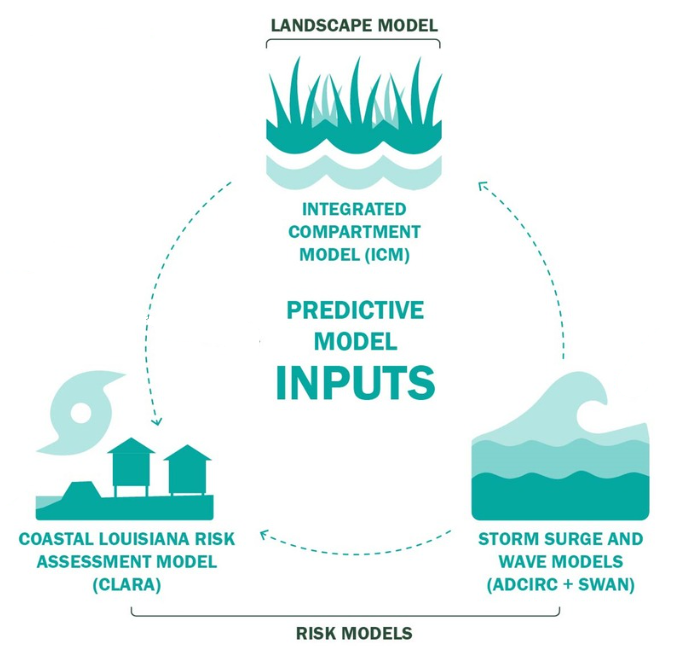

# Predictive Models

<figure>
    
    <figcaption>Figure 2. MP29 Predictive Models</figcaption>
</figure>

Analysis for Coastal Master Plan development primarily uses a set of four models (Figure 2). The Integrated Compartment Model (ICM) applies environmental inputs and scenario assumptions to simulate annual changes in hydrology, salinity, elevation, land and water distribution, vegetation, habitat, and related ecological conditions to predict landscape changes. Landscape outputs from the ICM serve as inputs to the Risk Models, including Advanced Circulation (ADCIRC) and Simulating Waves Nearshore (SWAN), which together predict storm surge and waves, and Coastal Louisiana Risk Assessment (CLARA), which uses those predictions along with information on coastal communities to predict damages from storms and assess flood risk.

Modeling outputs inform Metrics defined to support assessment of possible future conditions, evaluation of project effects, decision-making, and further coastal planning. The primary metrics that are used to evaluate projects relate to the primary goals of the coastal master plan—reduction in land loss for restoration projects and reduction in damages from storm surge-based flooding for risk-reduction projects.

Other, secondary metrics also provide valuable information and context related to project effects and tradeoffs. Examples of secondary metrics to be considered for MP29 include [Land Type](../results/land-water.md#land-type-plus); [Vegetation Community Type](../results/vegetation-habitat.md#vegetation-community-type-vct); [Forested, Fresh, Intermediate, Brackish, Saline (FFIBS) score](../results/vegetation-habitat.md#ffibs); [ICM-Habitat Suitability Indices (ICM-HSIs)](../results/vegetation-habitat.md#icm-habitat-suitability-indices-icm-hsis); [ICM-Habitat Diversity Index (ICM-HDI)](../results/vegetation-habitat.md#icm-habitat-diversity-index-icm-hdi); and [ICM-Wetland Value Assessments (ICM-WVAs)](../results/vegetation-habitat.md#icm-wetland-value-assessments-icm-wvas).

Exploration of these metrics can help us understand possible changes in land, habitat, and storm flooding. While maps demonstrate spatial patterns and extent of change at specific points in time, comparisons across years show patterns and trends over time. Comparison of results across scenarios also helps indicate how strongly changes depend on variable assumptions.

## Integrated Compartment Model (ICM) {/* #integrated-compartment-model-icm */}

### ICM Components

The ICM produces MP29 FWOA landscape results. The ICM components represent hydrology and salinity, wetland morphology and land change, vegetation, and habitat or ecological metrics. The components are linked and exchange information during annual simulations. For example, water levels and salinity can affect vegetation, which can affect organic matter accumulation. Changes in elevation and inundation can then affect the distribution of land and water.

_Table 3. Overview of ICM components with their primary functions and representative outputs._

| ICM Component | Primary Function | Representative Outputs |
| --- | --- | --- |
| ICM-Hydro | Simulates water movement, water level, salinity; produces hydrologic conditions that serve as inputs to other model components. | Water level, salinity |
| ICM-Morph | Simulates land-water transitions and elevation change via application of processes including sediment deposition, accretion, and subsidence. | Elevation, [land gain/loss](../results/land-water.md#land-change), [land type](../results/land-water.md#land-type-plus), land/water |
| ICM-LAVegMod | Simulates mortality, establishment, dispersal, and changes in cover of vegetation in response to environmental conditions. | Species distributions, [Vegetation Community Type](../results/vegetation-habitat.md#vegetation-community-type-vct), [FFIBS](../results/vegetation-habitat.md#ffibs) |
| ICM-HSIs | Translates landscape and vegetation outputs into habitat evaluation products. | [HSI results by species](../results/vegetation-habitat.md#icm-habitat-suitability-indices-icm-hsis) |

### Model Performance

Predictive models help us understand the changes that complex processes could produce over time, but it is important to note that all predictive models are limited by the data available to define their assumptions, their model structure, and uncertainties regarding represented processes as well as future conditions. Data to define certain modeled parameters and input conditions may be excellent for some locations and variables, but missing or low quality for others. Some coastal processes are easier to observe and represent than others. Models may simplify complex or less-well-understood processes using relationships based on monitoring data, scientific literature, and professional judgment.

Model performance is commonly assessed by comparing modeled results to observed data. These comparisons can use time-series plots, seasonal statistics, and error metrics. Assessment typically involves calibration and validation during model development and technical review. Calibration adjusts model parameters to improve agreement with observations, while validation then checks calibrated model results against additional observations. Technical review may examine methods, inputs, outputs, assumptions, and other documentation.

All ICM components have undergone performance assessment at various stages of their development, and technical review throughout their development, including by a Predictive Modeling Technical Advisory Committee (PM-TAC). ICM outputs are compared, for example, to project and reference monitoring data and observed landscape trends and known areas of change. Assessment of master plan predictive models is revisited as modeling methods are improved and as observations, starting conditions, and future assumptions are updated. Model performance may differ between plans, generally improving over time.

## Risk Models

MP29 Risk Models, ADCIRC + SWAN and CLARA, rely on ICM landscape outputs and assumptions about sea level rise and other existing and future conditions to estimate storm surge and waves and describe physical flood hazard. CLARA uses modeled flooding and information about exposed structures to estimate flood risk.

:::note

More information and detail on risk models will be added when outputs from those runs are available to share.

:::
