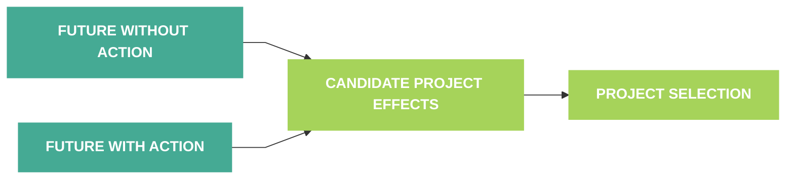

# What Could Louisiana's Coast Look Like in the Future?

The Coastal Protection and Restoration Authority (CPRA) is mandated to develop, implement, and enforce a comprehensive plan for coastal protection and restoration in coastal Louisiana. Currently in development, the 2029 Coastal Master Plan (MP29) uses observations and data, predictive models, and a suite of future scenarios to evaluate how coastal Louisiana could change over the next 50 years and how restoration and risk reduction projects could affect future conditions.

This page presents results of MP29 Future Without Action (FWOA) simulations as interactive maps and graphs. It also explains how to interpret those results, including the model inputs, assumptions, and limitations behind them.

## Why Does CPRA Model a Future Without Action? {/* #why-does-cpra-model-a-future-without-action */}

CPRA plans, implements, and manages restoration and risk reduction efforts across Louisiana’s coastal zone, and the Coastal Master Plan guides those efforts. To estimate what proposed projects could accomplish, a master plan needs a baseline that shows how the coast could change without them. For MP29, FWOA simulations represent coastal conditions from 2029 through 2079 _without_ restoration or risk reduction projects beyond those assumed to be completed before 2029. CPRA uses these simulations as the reference for evaluating project influence during project selection.

As MP29 development continues, CPRA will run Future With Action (FWA) simulations that use the same initial conditions, planning period, and future scenarios as FWOA. Each FWA simulation will include one or more MP29 Candidate Projects. CPRA will compare FWA results with FWOA results to estimate project effects (i.e., benefits and/or other impacts) and to select projects that advance long-term restoration and risk reduction goals.

## Interpreting FWOA Results {/* #interpreting-fwoa-results */}

FWOA results describe modeled conditions under the assumptions represented in each simulation. Outputs are typically provided as maps and/or time series graphs. Maps show modeled conditions for a specified period of time (e.g., daily, monthly, or annual), and graphs show how those conditions change over time.

Modeled results should not be interpreted as forecasts. The models capture many, but not all, of the factors that influence change in a complicated and dynamic coastal system, and some important factors and processes are still not fully understood. For example, assumptions must be made to estimate current land or water-bottom elevation where data are lacking, especially in shallow water areas next to land. Results are also limited by the capability of the modeling tools and by assumptions about model inputs, including how scenarios capture known uncertainty.

Considering results for multiple metrics from a scenario, year, and/or area together provides a fuller picture of potential future outcomes. For example, differences in outputs among scenarios show how metrics respond to different assumptions about the rate of sea level rise. As another example, land change can be driven by marsh edge erosion or by shifts in vegetation in response to environmental conditions that affect elevation. Exploring multiple metrics can help clarify what is driving the changes observed at a specific location.

## Exploring FWOA Results {/* #exploring-fwoa-results */}

MP29 FWOA results are available first from the Integrated Compartment Model (ICM), which simulates how Louisiana’s coastal landscape may change in the future, to be followed by results from the master plan risk models (Advanced Circulation and Simulating Waves Nearshore [ADCIRC+SWAN] and the Coastal Louisiana Risk Assessment [CLARA] model).

FWOA modeling examines how the coast could change if no additional projects are implemented beyond those assumed to be completed before 2029. Because future environmental conditions cannot be predicted with certainty, CPRA evaluated a range of possible scenarios for FWOA. The predictive models are connected: they consider interactions across the coast and changes over time, so what happens in one part of the system can influence conditions elsewhere or affect results later in a simulation.

## Scenario-Specific FWOA Results {/* #scenario-specific-fwoa-results */}

FWOA outputs are available for multiple scenarios, each assuming a different rate of sea level rise. For the currently available outputs, all scenarios draw on the CMIP6 SSP2-4.5 scenario for climate forcings, which represents “middle-of-the-road” conditions in which recent greenhouse gas emissions trends and current policies continue. Each scenario also includes future trajectories for environmental variables such as precipitation and temperature (also derived from CMIP6 SSP2-4.5) and for subsidence (sinking of the ground). These other climate-related conditions vary spatially and/or over time but not between scenarios.

After FWA runs are complete, CPRA will use results from two scenarios for project selection: **MP29 Scenarios A and B.** **MP29 Scenario A is a more central projection** that represents the median estimates based on “middle-of-the-road” climate assumptions. **MP29 Scenario B includes a less optimistic rate of sea level rise** that is less likely, but still possible, under the same climate assumptions. Scenario B is included because more rapid sea level rise, if it occurs, would significantly affect coastal conditions and the performance of some projects. Evaluating MP29 Candidate Projects under both scenarios helps identify projects expected to perform robustly across the range of possible future conditions evaluated, given related climate change assumptions.
